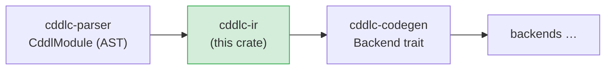
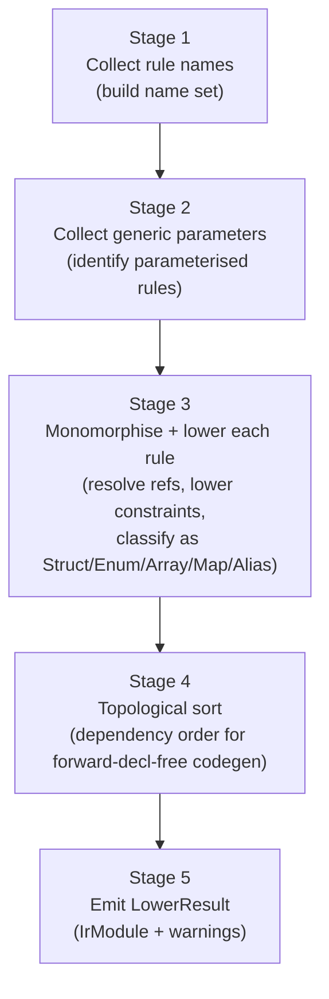

# cddlc-ir

Converts the raw `CddlModule` AST produced by `cddlc-parser` into a fully resolved,
semantically typed Intermediate Representation (IR).  Every backend works exclusively
against the IR — no backend ever touches the raw AST.

## Position in the pipeline



## Lowering stages

The `lower()` function performs the following stages in order:



### Stage 3 in detail — type classification

Each CDDL rule is classified into exactly one of five IR variants:

| IR variant | CDDL pattern | Example |
|---|---|---|
| `StructDef` | `{ field: T, … }` — named map group | `device = { id: tstr, active: bool }` |
| `EnumDef` | `T1 / T2 / …` — type choice | `status = "ok" / "warn" / "error"` |
| `ArrayDef` | `[* T]`, `[+ T]`, `[n*m T]` | `readings = [* float32]` |
| `MapDef` | `{ * K => V }` — open map | `props = { * tstr => any }` |
| `AliasDef` | any other single-type expression | `device-id = tstr .size 16` |

## Public API

```rust
/// Entry point — lowers a parsed CddlModule into a typed IR.
pub fn lower(
    module: &CddlModule,
    default_max_array: u32,
    default_max_str: u32,
) -> Result<LowerResult, LowerError>;

/// Result of lowering
pub struct LowerResult {
    pub module:   IrModule,
    pub warnings: Vec<String>,
}

/// The fully-resolved module used by all backends
pub struct IrModule {
    pub name:  String,
    pub types: IndexMap<String, TypeDef>,   // ordered by dependency
}

impl IrModule {
    /// Resolve a named type to its TypeDef, if present
    pub fn get(&self, name: &str) -> Option<&TypeDef>;
}
```

### Core IR types

```rust
pub enum TypeDef {
    Struct(StructDef),
    Enum(EnumDef),
    Array(ArrayDef),
    Map(MapDef),
    Alias(AliasDef),
}

pub struct StructDef {
    pub fields:   Vec<FieldDef>,
    pub pragmas:  Vec<Pragma>,
}

pub struct FieldDef {
    pub name:     String,
    pub key:      FieldKey,         // Named string key or integer key
    pub ty:       TypeRef,
    pub optional: bool,
    pub pragmas:  Vec<Pragma>,
}

pub enum TypeRef {
    Primitive(Primitive),           // bool, uint, int, float32/64, tstr, bstr, any
    Named(String),                  // reference to another rule in the module
    Choice(Vec<TypeRef>),           // inline type choice
    Array { ty: Box<TypeRef>, capacity: u32 },
    Map   { key: Box<TypeRef>, value: Box<TypeRef> },
    Tag   { number: u64, inner: Box<TypeRef> },
    Constrained { ty: Box<TypeRef>, constraint: Constraint },
}

pub enum Primitive { Bool, Uint, Int, Float32, Float64, Tstr, Bstr, Any, Nil }

pub enum EnumVariant {
    Text(String),                   // "ok"
    Int(i64),                       // 1, -1
    Named(String),                  // reference to another type
}
```

### Constraint representation

Constraints are lowered from AST `.control` expressions into a typed `Constraint` enum:

| CDDL syntax | `Constraint` variant |
|---|---|
| `.size N` | `Size(LiteralValue)` |
| `.size (min..max)` | `SizeRange(min, max)` |
| `.ge N` / `.le N` / `.gt N` / `.lt N` | `Ge/Le/Gt/Lt(LiteralValue)` |
| `.eq V` / `.ne V` | `Eq/Ne(LiteralValue)` |
| `.range (min..max)` | `Range { min, max, inclusive }` |
| `.regexp "pat"` | `Regexp(String)` |
| `.cbor T` | `Cbor(TypeRef)` |
| `.cborseq T` | `CborSeq(TypeRef)` |

### Pragma propagation

Pragmas attached to rules in the AST are preserved on IR nodes so backends can act on them:

| Pragma | IR effect |
|---|---|
| `@capacity N` | Overrides the default `max_array` for array-typed fields |
| `@str-capacity N` | Overrides the default `max_str` for `tstr` fields |
| `@doc "text"` | Stored on `StructDef` / `EnumDef` / `AliasDef` for doc-comment generation |
| `@deprecated` | Stored; backends emit `#[deprecated]` / `@Deprecated` / `@deprecated` |
| `@default V` | Stored on `FieldDef` for optional-field default generation |
| `@regex-hook name` | Stored on `FieldDef`; used by C/Rust backends for `.regexp` hooks |
| `@skip-validation` | Stored; suppresses constraint-check emission |
| `@opaque` | Stored; backends treat the field as raw bytes |

## Topological sort

After all types are lowered, the IR is sorted so that every type appears after all the types
it references.  This allows backends to emit forward-declaration-free code — the type table
is always in dependency order.  Mutual recursion is detected and reported as a
`LowerError::Cycle`.

## Known gaps and future enhancements

- **Generics with multiple parameters** (`pair<T, U>`) — monomorphisation works for one
  parameter; two-parameter generics may not resolve correctly in all cases.
- **Group-level choices** (`//=` augmentations) — only the first variant of a group choice
  is currently lowered; alternatives are dropped.
- **Unwrapped groups** (`~name`) — parsed but treated as a plain named reference.
- **`* field: T` occurrence in structs** — repeated struct fields (occurrence other than `?`)
  are not modelled; they are lowered as single optional fields.
- **Socket/plug rules** (`$socket /= T`) — the final merged type is not computed.
- **Cross-module topological sort** — when multiple files are loaded and merged, the topo-sort
  operates on the merged rule set; a rule-set that is only acyclic when files are considered
  separately may be reported as a cycle.
- **Better error messages** — `LowerError` currently carries plain strings; structured errors
  with spans would allow the CLI to render precise source locations.

## License

MIT OR Apache-2.0
